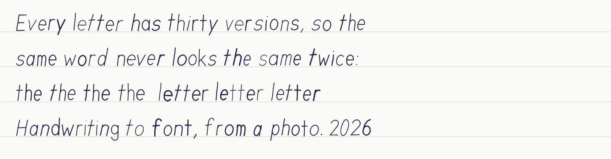
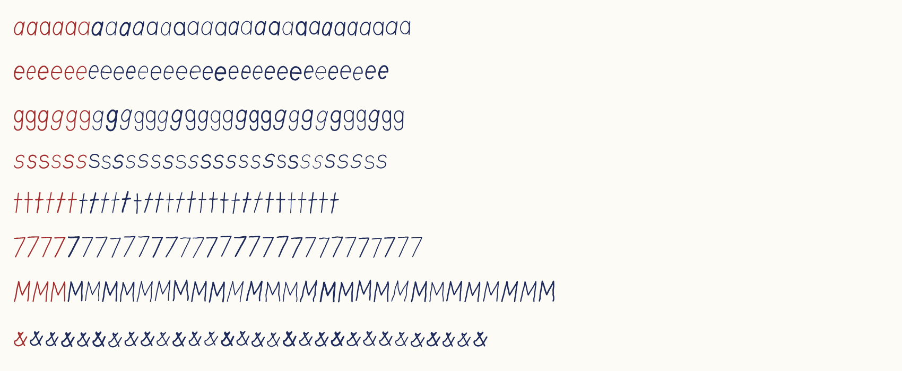
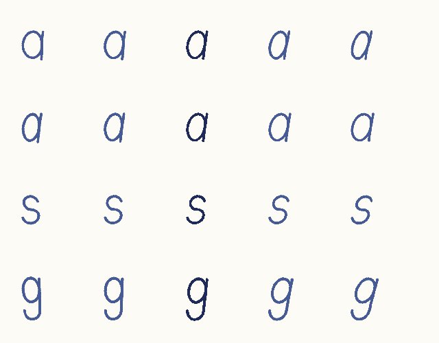
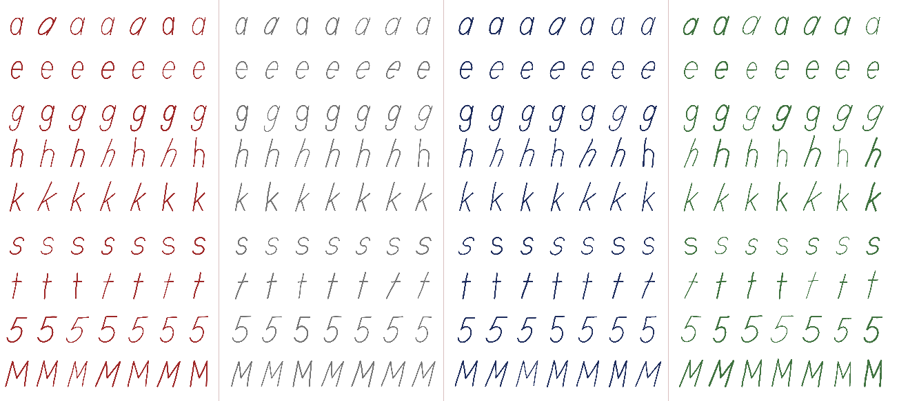

# Inkforge

**Turn real handwriting into a real font, one that varies like a hand instead of stamping the same shape every time.**



<sub>All images in this README use a synthetic demo writer, not a real person's handwriting.</sub>

Inkforge reads handwriting (printed capture sheets, photos of pages you already wrote, or a
pen pad), measures how the writer's hand behaves, learns how each of their letters varies, and
writes a TrueType font with up to **64 versions of every character**. The font picks a
different version as you type, so double letters and repeated words never look identical.
This works in browsers, Word (with *Contextual Alternates* on), Adobe apps and Figma.

Everything is written from scratch in plain JavaScript with **zero runtime dependencies**:
image processing, outline tracing, the TrueType/OpenType writer, the handwriting analyser and
the learned shape model.

## Quick start

```bash
node bin/inkforge.js --app        # http://127.0.0.1:7431, opens in an app window
```

Requires Node 22+. To try it without writing anything, open **Library** and click
**Load demo writer**, then go to **Font** or **Write**.

```bash
npm test                          # 21 tests: font writer, tracer, analyser, model, PDF...
npm install && npm run build:exe  # Windows: dist/Inkforge.exe, a double-click desktop app
```

## What it does

| Step | |
|---|---|
| **Capture** | Print capture sheets (corner markers + a page code), photograph them at any angle; they are rectified with a homography and every box is read. Or use photos of pages you already wrote, or a pen pad (pressure becomes stroke width). |
| **Analyze** | Finds the paper on a desk, flattens shadows, splits lines and letters, and measures the hand: slant and its spread, stroke width, x-height, ascender/descender ratios, baseline drift and bounce, size consistency, letter and word spacing. |
| **Harvest** | Given the text of a page, finds the letters even in joined-up writing: lines are matched to text, each line is over-cut at thin joins, and dynamic programming assigns characters to pieces by expected width, word gaps and resemblance to the writer's other copies. |
| **Learn** | A statistical shape model learns how each of the writer's letters varies and generates new copies in the same hand (below). |
| **Font** | TrueType with up to 64 versions per character, a contextual version-switching state machine, optical kerning from the real ink, and handwritten ligatures. |
| **Write** | A Word-style editor that sets text in the font with line and word wobble, ruled/graph/legal paper, ink colours, per-line sizes, margins, a version X-ray, and exact PDF export. |



## The learned handwriting model

`src/core/learn.js` is a statistical shape model of the writer's hand, trained on the
writer's own samples inside the app (no pre-trained weights):

1. Every copy of a letter is placed in a baseline-aligned frame and turned into a signed
   distance field.
2. Each copy is registered to the most typical one with *demons* registration, giving a
   smooth deformation field: how this copy differs from the typical one.
3. Principal component analysis of those fields finds the main ways the letter varies
   (lean, width, loop size, stroke reach) and how much.
4. New copies sample those patterns, scaled by a *creativity* setting, and warp the writer's
   real drawings, so they are new shapes with real strokes. Letters with fewer than 3
   copies use habits pooled across all letters.



### Evaluation

`node scripts/learn-eval.mjs` tests the model on six synthetic writers with known variation
(20 training copies and 20 held-out copies per letter), against the previous method of random
tilt, scale, wobble and pressure on real copies:

| Metric (average of 6 writers) | Learned model | Previous method | Ideal |
|---|---|---|---|
| 1-NN two-sample test vs unseen real copies | **57%** | 70% | 50% (real vs real: 47%) |
| Novelty (distance to training / a real new copy's) | **0.99** | 1.37 | 1.0 |
| Variation spread error (log ratio) | **0.24** | 0.63 | 0 |
| Feature offset (width, height, slant, ink; in SDs) | **0.31** | 0.56 | 0 |
| Variation of unseen copies explained | **93%** | — | 100% |

The learned patterns correlate with the true causes of variation at 83–99% for slant and width
and 59–72% for ascender reach. They correlate weakly with pen weight (the model deforms
strokes rather than thickening them) and, correctly, with random wobble and tremor, which have
no consistent direction to learn.



## How the font varies

- **Versions:** real copies first, then learned copies, up to 64 per character (digits can
  have more than letters).
- **Choosing a version:** a GSUB `calt` state machine, compiled from one shared formula
  (`src/core/versions.js`). Each character group walks its own shuffled cycle through all
  versions, and the state carries across spaces, so the same word comes out differently each
  time. Spaces have versions too, so word gaps vary as well.
- **Exactness:** the app predicts the same versions the font produces. This was checked against
  Chrome's shaping to 0.00 px on whole sentences, which lets the Write tab's X-ray and PDF export
  draw exactly what is on screen. Browsers split text into runs by script, so the invisible
  context characters used for this are rare *Latin* letters (U+AB30–AB5A, U+A730–A76F).
- **Size limits:** coverage and class tables use whichever OpenType format is smaller, so a
  64-version font (about 6,500 glyphs) fits the 64 KB offset limits.

## Privacy

Your handwriting never lives in the repository. The library is kept in the browser and in
`%LOCALAPPDATA%\Inkforge\project.json` (set `INKFORGE_DATA` to use another folder). Folders
for exported fonts and debug images are git-ignored, and the evaluation uses synthetic writers
unless you pass `--include-mine`.

## Project layout

```
src/core/    raster, trace, glyph, ttf (font writer), fontbuilder, versions, learn,
             analyze, align, harvest, consensus, template, page, fillin, writers, pdf
src/ui/      app, write (editor), model (Model tab), worker, drawpad, store, render
src/         server.js (local server + project API), launch.js, index.html, print.html
bin/         CLI entry          scripts/  exe build, model evaluation, README images
test/        tests + an independent TrueType reader
```

## Limitations

- Harvesting letters from joined-up writing is the weakest step. Expect to review the
  candidates; printed capture sheets or the pen pad give the cleanest samples.
- The model needs about 3+ copies of a letter to learn that letter's own patterns, and with
  few copies it varies a little less than the real hand.
- The first font build with the model takes roughly 20 s, or longer at 64 versions. Later
  builds are cached.
- The desktop build targets Windows. The web app runs anywhere Node and a modern browser do.

## License

MIT, see [LICENSE](LICENSE).
